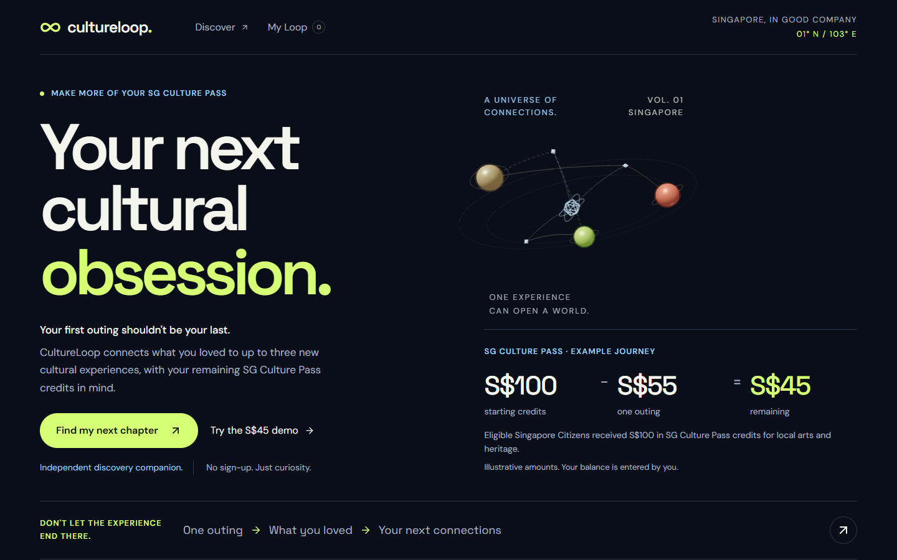

# CultureLoop

**Don't let the experience end there.**

CultureLoop helps you connect your last cultural outing to your next Singapore cultural discovery, with your remaining SG Culture Pass credits in mind.

Built by **Malcolm Toh Jia Jun**, a solo participant in **COMMON GROUND — One Day Creative Tech Makeathon**, Singapore, 11 October 2026. Culture × Tech is the confirmed track; Design × Tech is a proposed additional selection.



## The idea

Eligible Singapore Citizens received S$100 in SG Culture Pass credits. Imagine using S$55 for an outing, enjoying it, then wondering what to try with the remaining S$45. CultureLoop explores whether connecting what you enjoyed to another art form can make that next outing feel personal and appealing.

This is a product hypothesis, not a claim that unused credits or repeat participation have been measured. The S$55/S$45 story is illustrative. CultureLoop is an independent discovery companion, not an official redemption service.

## What works

- Enter your own remaining balance and reflect on a previous experience.
- Select up to five interests and a social occasion.
- Receive **up to three event recommendations from 20 sourced catalogue records**, with an explanation for each connection.
- Explore a **moving 3D constellation**: forming connections, drifting nodes, rotating rings, camera transitions and a guided memory → taste → event journey.
- Switch to an equivalent list view, or use accessible event buttons without rotating the scene.
- Start an **original taste-based soundtrack** yourself, with play/pause, mute, volume and smooth event sound transitions.
- Open cultural previews with source-supported notes, practical event information and official listing links.
- Swap one recommendation, save experiences and add an optional personal note. Preferences and saves persist in your browser.
- Optionally ask AI to interpret a short memory into suggestions you can review, edit and accept. The manual flow works without it.

There are three recommended **event** nodes at most; memory and interest nodes provide context and are not extra choices. Similar profiles can receive similar maps. Short or empty eligible pools are not padded with invented events.

## Run it without credentials

Requires **Node.js 22.12+ and npm**; developed with Node 24.

```sh
git clone https://github.com/MT7654/cultureloop.git
cd cultureloop/app
npm ci
npm run dev -- --port 5173
```

Open **http://127.0.0.1:5173/**. No account, database connection, OpenAI key or root dependency install is required for the complete manual journey. Local fonts, original artwork, event records and Web Audio synthesis are included.

## Two-minute demo

1. Read the landing premise and clearly labelled credit example. Select **Try the S$45 demo**.
2. Review the manually entered story/balance, then select **What moves you**.
3. Select or remix your interests and occasion. Optionally start the original soundtrack.
4. Select **Reveal my CultureLoop**. Rotate the constellation or choose an event through its button. **Follow a connection** reveals the actual memory/taste/event relationship.
5. Select **Explore this**. Read why it fits, inspect the source/date/price caveats, and play the labelled interpretation if desired.
6. **Save to My Loop**, add a reason or note, and open the collection. Reload to see persistence. Saving leaves your S$45 unchanged.

Exact event titles depend on your choices and the current Singapore date. Expired events leave recommendations. The demo does not claim an actual government balance or attendance history. See the [walkthrough](docs/demo-walkthrough.md) and [silent manual demo recording](docs/demo/cultureloop-manual-demo.webm).

## For judges and automated reviewers

[EVALUATION.md](EVALUATION.md) provides runnable checks, observable expectations, failure behaviour and exact source pointers. [AGENTS.md](AGENTS.md) is the concise repository entrypoint. Both describe evidence to inspect; neither replaces judging or asks reviewers to assume claims are true.

From `app/`:

```sh
npm test
node scripts/ai-handler-check.mjs
npm run build
```

For browser checks, leave the development server running on port 5173 and use a second terminal in `app/`:

```sh
npm run test:browser
```

Playwright is configured for installed **Google Chrome**. If unavailable, install a supported Chromium and adjust the `channel` in `app/playwright.config.ts`. Windows restricted shells can block local browser networking or Vite file resolution; use a normal authorised terminal.

Recorded verification on 11 October 2026: **40 unit tests, 38 Chrome browser tests, 16 server mock checks and a production build passed** after the immersive upgrade. The later landing-copy change passed **15 targeted browser regressions**, four-size fresh/returning captures and another production build. These are recorded results, not a guarantee that every environment/device passes. [Test notes](docs/test-notes.md), [latest landing evidence](docs/visual-qa/culture-pass-landing/final/checks.json), [immersive review](docs/immersive-upgrade.md).

## How it is built

| Area | Implementation and evidence |
|---|---|
| Interface | React, TypeScript, Vite, Tailwind CSS and Motion; six screens coordinated by [App.tsx](app/src/App.tsx) |
| Recommendations | Deterministic interest, memory, occasion, budget, editorial bridge and date scoring in [recommend.ts](app/src/domain/recommend.ts); eligibility/expiry guards run first |
| Catalogue | Twenty curated source records in [events.ts](app/src/data/events.ts), supported by [provenance](docs/data-provenance.md) |
| Spatial exploration | Three.js, React Three Fiber and Drei in [Constellation3D.tsx](app/src/components/Constellation3D.tsx), shared [motion logic](app/src/components/spatial-motion.ts) |
| Sound | Original Web Audio synthesis in [Atmosphere.tsx](app/src/components/Atmosphere.tsx), derived from [onboarding tastes](app/src/domain/sound-profile.ts) |
| Persistence | Validated localStorage profile/saves and sessionStorage navigation; [profile.ts](app/src/domain/profile.ts), [session.ts](app/src/domain/session.ts) |
| Optional AI | Server-only OpenAI Responses handler in [ai-handler.mjs](app/server/ai-handler.mjs), local Vite middleware and Vercel Node functions |
| Design research | Actual Mobbin Spotify/DICE references and two Figma directions; [references](docs/design-references.md), [redesign audit](docs/redesign-audit.md) |

AI does **not** invent events, supply ticket facts or replace the deterministic ranking. Memory suggestions require user acceptance. Event narration selects approved note IDs; the server assembles trusted text. Missing configuration, invalid responses or provider failure leave manual choices usable. See [AI implementation](docs/ai-implementation.md).

## Optional AI setup

Copy root `.env.example` to root `.env.local` and add your own `OPENAI_API_KEY`. The local Vite server reads it server-side; never use a `VITE_` prefix for credentials. The default configured model is `gpt-4o-mini`.

A single real local memory smoke test was recorded; the automated server checks use mocks. `node scripts/ai-smoke.mjs` is an **optional paid provider check**, not a required evaluator step. Submitted memory text is sent to OpenAI only on the explicit AI action. No raw memory history is stored as a cloud database feature.

## Deployment and Neon

For Vercel, select repository root directory **`app`**, install `npm ci`, build `npm run build`, output **`dist`**. Hash navigation is used. The included Node API handlers support optional AI; hosting credentials must be configured separately from local files. Public paid endpoints remain disabled unless `CULTURELOOP_AI_PUBLIC_ENABLED=true` is deliberately set after hosting abuse/spending controls are configured. A process-local limiter is not distributed protection.

Neon was linked/provisioned during the makeathon. Root `neon.ts` describes a private `uploads` bucket. **The app does not currently query Neon or cloud-sync user journeys.** Its working persistence is localStorage. The infrastructure project is not needed to run or evaluate the frontend. No authentication, payment or Singpass integration is included. [Neon setup and boundaries](docs/neon-setup.md).

This source repository is available on GitHub. **No public hosted application URL has yet been verified**; localhost is only usable on the running computer. A frontend deployment is separate from `neon deploy`.

## Data, cultural meaning and limitations

- Catalogue eligibility is a **source snapshot checked 11 October 2026**, not live bookable inventory. Some primary pages required indexed evidence; all availability is unknown. Reconfirm price tiers, sessions and eligibility with the ticketing provider. Coverage is uneven and the catalogue will age.
- Cultural bridges are explainable editorial connections supported by programme descriptions, not claims of historical lineage, cultural authority or organiser endorsement.
- Original posters and synthesised sound are labelled **creative interpretations**, not event photographs or authentic event recordings. No official SG Culture Pass logo or eligibility icon is reproduced.
- Reduced motion and pause stop ambient scene motion; deliberate navigation remains available. Hidden/offscreen scenes suspend work. WebGL failure has a relationship-map/list alternative.
- Fresh visits show welcome with a continue/new-exploration choice; same-tab refresh resumes navigation. A new exploration preserves saves/balance, and **Clear all data** is separately confirmed.
- Formal user validation, impact measurement, physical-device/Safari coverage and formal screen-reader certification remain outstanding. Source snapshots and local automated checks should not be treated as those results.

## Credits and further reading

Malcolm directed the concept, scope, design choices and review. **Codex** assisted research, implementation, testing and documentation, including this README. Mobbin references informed interface patterns; Figma MCP produced editable direction studies. OpenAI is an optional runtime memory assistant. Agents are tools, not additional human teammates.

Third-party libraries retain their licences. Bundled font licence notices are in [app/public/licenses](app/public/licenses). Official event descriptions are paraphrased and sources attributed in catalogue/provenance documents; competitor artwork was not copied. Claimly's [README/evaluator structure](https://github.com/MT7654/Claimly) informed this documentation's reproducible checks and clear boundaries; its product, integrations and scoring were not copied.

- [Evaluator guide](EVALUATION.md)
- [Detailed application setup](app/README.md)
- [Submission draft](docs/submission-draft.md) — draft, not an externally submitted form
- [Current project knowledge](PROJECT-KNOWLEDGE.md) — latest sections supersede historical milestones
- [Preserved Common Ground kit](common-ground-kit/START-HERE.md)

CultureLoop is not affiliated with or endorsed by SG Culture Pass, MCCY or the Singapore Government. Balances are entered by users; credits are not linked or redeemed here.
